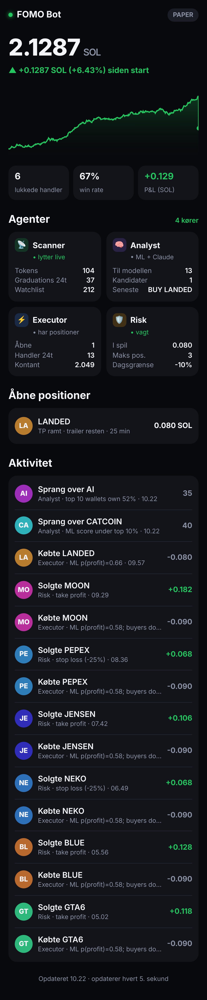

# FOMO Tradebot

En automatisk trading-bot til Solana-memecoins, bygget til at handle fra den samme wallet som du bruger i FOMO-appen.

> **Vigtigt:** FOMO har ikke et offentligt trading-API. Botten handler derfor **direkte on-chain** via Jupiter
> (samme likviditet som FOMO selv bruger). Hvis du eksporterer din FOMO-wallets private key og giver den til
> botten, dukker dens køb og salg op i din FOMO-portefølje. Du kan også bruge en separat wallet.

> **Risiko:** Memecoins er ekstremt risikable, og de fleste ender på nul. Botten kan tabe penge. Start altid i
> **paper mode** (simuleret handel, standard), og brug kun beløb du har råd til at tabe, når du går live.

## Strategien, og hvorfor

Strategien er bygget på data, ikke mavefornemmelse (se [research/README.md](research/README.md)). Testet på 31.000
rigtige memecoins:

- At købe alle nye tokens gav **-11 % pr. handel**.
- Momentum-signaler alene gav **ingen edge** frem for tilfældige køb.
- En model, der udvælger de bedste 10 % af helt nye tokens, gav **+14 % pr. handel** på en uge, den ikke var trænet på,
  og **+26 % (58 % vindere)** sammen med bottens testede sikkerhedsfiltre (48 handler).

Botten handler derfor kun helt nye tokens (2-30 minutter gamle), som modellen rangerer i top 10 %.

## Hvordan botten tænker

Hver 30. sekund kører den denne pipeline:

1. **Opdagelse.** Lytter i realtid efter pump.fun-graduations via PumpPortals gratis websocket. Det er netop
   modellens domæne. Derudover henter den nye pools fra GeckoTerminal og nye og trending tokens fra DexScreener.
   Unge tokens bliver på en watchlist og vurderes igen hver tick, indtil de er 30 minutter gamle.
2. **Sikkerhed (testede filtre).** Afviser tokens med mint- eller freeze-authority, top-10-wallets over 30 %, en
   creator der stadig ejer over 5 %, insider-netværk over 15 %, transfer-fees, under 50 holders, under $10k
   likviditet eller under $15k market cap. Data kommer fra RugCheck, og AMM-pools tælles ikke med som holders.
   Filtrene er testet på 31k tokens: sammen med modellen gav de +26 % pr. handel mod +14 % uden. Et krav om låst LP
   fjernede de bedste handler, så ulåst LP giver i stedet halv positionsstørrelse.
3. **ML-model (valideret).** En model trænet på ~11.000 rigtige memecoin-handler vurderer sandsynligheden for, at en
   handel ender i overskud. Den ser på market cap, likviditet, LP-burn, alder, dev-beholdning, momentum, køb/salg og
   holders. Kun top 10 % går videre, og kun tokens inden for modellens træningsdomæne (≤30 minutter gamle).
4. **Kvantitativ analyse.** Momentum, volumenacceleration, købstryk, likviditet/market cap, EMA-trend, RSI og
   volatilitet samles i en score med begrundelser. Den bruges som supplerende information.
5. **Intelligens (Claude).** Kandidaterne sendes til Claude (Opus 5.5) sammen med modellens sandsynlighed,
   porteføljen og **lektioner fra tidligere handler**. Claude kan nedlægge veto mod setups med røde flag, som
   modellen ikke kan se, og vælger conviction, størrelse, take-profit og stop-loss. Uden en API-nøgle køber botten
   på modellen alene.
6. **Honeypot-test.** Før hvert køb henter botten et quote for at købe og straks sælge igen via Jupiter. Er der ingen
   salgsrute, eller vil turen koste over 10 %, købes der ikke. I paper mode bruges den målte pris som slippage.
7. **Risikostyring.** Positionsstørrelse skaleres efter conviction. Der er loft over antal positioner, samlet
   eksponering og SOL pr. handel, og der holdes en SOL-reserve til fees. En **daglig tabsgrænse** og en **pause efter
   flere tab i træk** stopper nye køb.
8. **Exits (valideret).** Stop-loss 25 %, salg af 50 % ved +100 %, trailing stop 35 % på resten, aldrig under
   entry efter take-profit, exit hvis likviditeten kollapser, og max 4 timer.
9. **Læring.** Når en handel lukkes, skriver Claude en kort lektion. Lektionen gemmes og bruges i fremtidige
   beslutninger.

Alt logges i SQLite (`fomobot.db`): beslutninger med begrundelse, handler, positioner, priser og lektioner.

## Kom i gang

```bash
pip install -e .              # installerer kommandoen `fomobot` (eller: pip install -r requirements.txt)
cp .env.example .env          # indsæt din ANTHROPIC_API_KEY
python -m fomobot scan        # analysér markedet én gang uden at handle
python -m fomobot run         # paper trading (simuleret, start-saldo 5 SOL)
python -m fomobot status      # åbne positioner
python -m fomobot report      # resultater, win rate og lærte lektioner
```

## Dashboard på telefonen

```bash
fomobot run --dashboard     # botten + dashboard
fomobot dashboard           # kun dashboardet
```

Åbn adressen, der vises i loggen (fx `http://192.168.1.20:8080`), på telefonen på samme Wi-Fi. Du ser de fire agenter
(Scanner, Analyst, Executor, Risk), saldo-graf, åbne positioner og live-aktivitet. Siden kan kun læse og viser
ingen nøgler.



*(Skærmbilledet viser demodata.)*

## Følg botten fra telefonen (Telegram)

Botten kan skrive til dig ved hvert køb, salg og lukket handel med P&L og sende en daglig status. Opsætningen tager
2 minutter og kan klares fra telefonen:

1. Skriv til **@BotFather** i Telegram, send `/newbot` og kopiér token til `TELEGRAM_BOT_TOKEN` i `.env`.
2. Send en besked til din nye bot. Åbn `https://api.telegram.org/bot<TOKEN>/getUpdates` og kopiér `"chat":{"id":...}`
   til `TELEGRAM_CHAT_ID`.

Hver besked starter med 📝 PAPER eller 🔴 LIVE, så en simuleret handel aldrig kan forveksles med en rigtig.

## Backtest på rigtige data

```bash
python -m fomobot collect     # henter minut-candles for et par hundrede Solana-memecoin-pools (GeckoTerminal, gratis)
python -m fomobot backtest    # tuner entry og exit på halvdelen af tokens og tester på den anden halvdel
```

Backtesten er bevidst konservativ: den køber på næste candles åbning, regner gebyr og slippage ind på begge sider,
lader stops glide yderligere, og hvis stop-loss og take-profit rammes i samme candle, antager den stop-loss. Den
sammenligner med tilfældige entries med de samme exits for at vise, om entry-signalet faktisk tilfører noget.
Resultatet gemmes i `data/history/backtest_result.json`. Den nuværende konklusion er, at momentum på ældre
trending-tokens ikke har nogen edge (se research).

Hvad backtesten ikke kan se: holder-data, RugCheck og købs-/salgsantal bagud i tid. De filtre fjerner kun handler,
så de valideres i paper mode.

## Lille konto (fx 1000 kr fra Coinbase)

`config.yaml` er sat op til ca. 2 SOL: maks. 0,1 SOL pr. handel, maks. 3 positioner, maks. 25 % af kontoen i spil
og 0,1 SOL i reserve til gebyrer. Nye køb stopper efter en dag med 10 % tab eller efter 3 tab i træk (2 timers pause).
Paper mode regner med 0,003 SOL i faste gebyrer pr. køb. Live lukker botten token-kontoen efter hvert fuldt salg og
får dens rent (~0,002 SOL) tilbage.

Sådan kommer pengene fra Coinbase til botten (det gør kontoens ejer selv):

1. Kør paper mode i 3-7 dage og tjek `fomobot report`. Hvis resultatet ligger langt under researchen, så stop her.
2. Kør `fomobot wallet`. Den laver bottens egen Solana-wallet (ingen Phantom nødvendig), gemmer nøglen i `.env` og
   viser adressen.
3. Køb SOL på Coinbase og send dem til den adresse (vælg Solana-netværket). Start småt, fx 0,3-0,5 SOL.
4. Sæt `SOLANA_RPC_URL` i `.env` til en rigtig RPC (fx en gratis Helius-nøgle). Tag en backup af `.env`, for uden
   nøglen er pengene væk.
5. Sæt `execution.mode: live` i `config.yaml` og start med `fomobot run --live`.

## Gå live (rigtige penge)

1. Lad botten køre i paper mode i mindst et par dage, og tjek `report`.
2. Sæt `SOLANA_RPC_URL` (brug en betalt RPC, fx Helius eller QuickNode, for pålidelighed) og `WALLET_PRIVATE_KEY`
   (base58) i `.env`.
3. Sæt `execution.mode: live` i `config.yaml`.
4. Start med `python -m fomobot run --live`.

Begge dele kræves (config og flag), så du ikke handler med rigtige penge ved en fejl. Live-data gemmes i en separat
database (`fomobot-live.db`). Din private key forlader aldrig din maskine: transaktioner signeres lokalt.

## Tilpasning

Hele strategien styres fra `config.yaml`: sikkerhedsgrænser, score-tærskler, TP/SL, positionsstørrelse,
tabsgrænser, Claude-model og effort samt maks. antal Claude-kald i timen (for at holde omkostningen nede).

## Struktur

```
fomobot/
  data/          DexScreener, GeckoTerminal (markedsdata) og RugCheck (sikkerhed)
  analysis/      safety.py (filtre), gate.py (backtestet entry-port), indicators.py, scorer.py
  backtest/      dataset.py (GeckoTerminal-data), engine.py (simulator), report.py
  intelligence/  analyst.py (Claude: beslutninger og refleksion), ml.py + memecoin_model.joblib (udvælgelse)
  execution/     paper.py (simulering), jupiter.py (live swaps på Solana)
  risk.py        sizing, limits, circuit breakers, exit-regler
  engine.py      hovedloopet
  storage.py     SQLite
research/        analyse af 31k memecoins og træning af ML-modellen
tests/           pytest-suite med falske markedsdata
```

Kør tests med `python -m pytest`.

## Kilder og inspiration

- [ian05012/solana-memecoin-dataset](https://github.com/ian05012/solana-memecoin-dataset): træningsdata for ML-modellen.
- [vineetdev02/Memcoin-Sniper-Bot](https://github.com/vineetdev02/Memcoin-Sniper-Bot): idéen om at teste salget før
  købet (honeypot-test).
- [chainstacklabs/pumpfun-bonkfun-bot](https://github.com/chainstacklabs/pumpfun-bonkfun-bot): top-10-holder-tjekket
  (maks. 30 %) og at gå ind ved migration til PumpSwap.
- PumpPortal (graduations), DexScreener, GeckoTerminal, RugCheck og Jupiter: gratis API'er.
